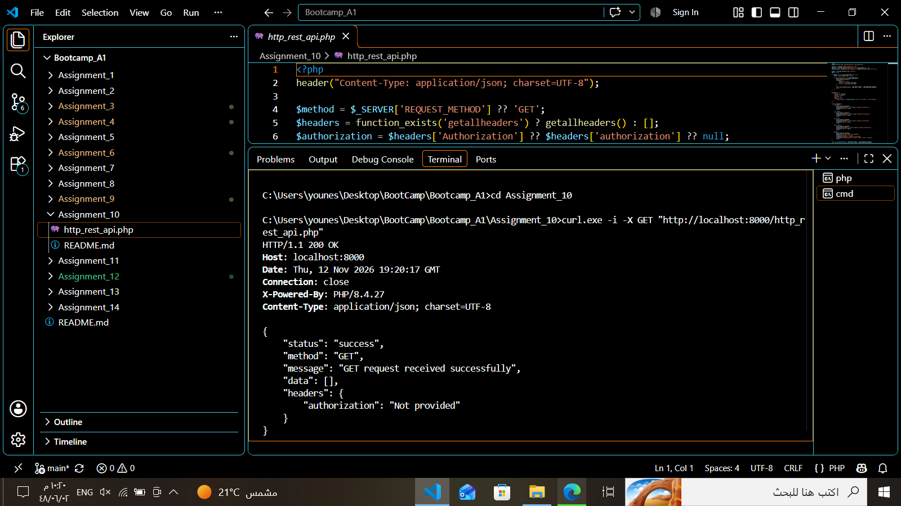
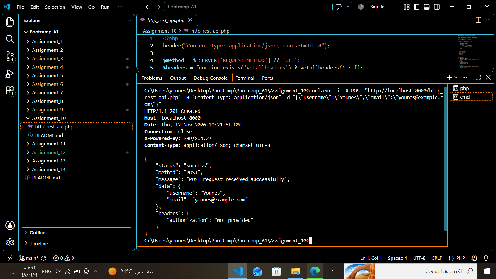
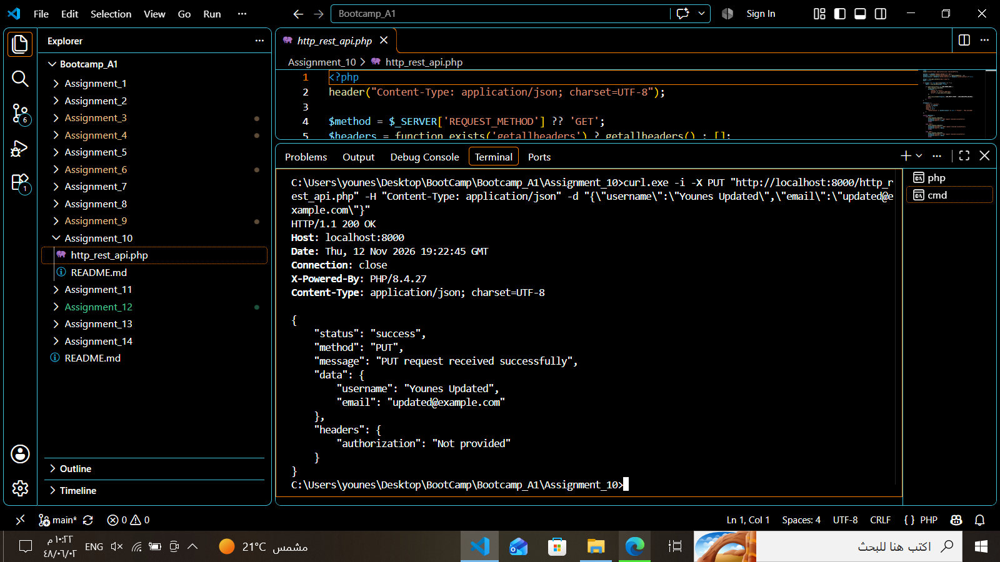
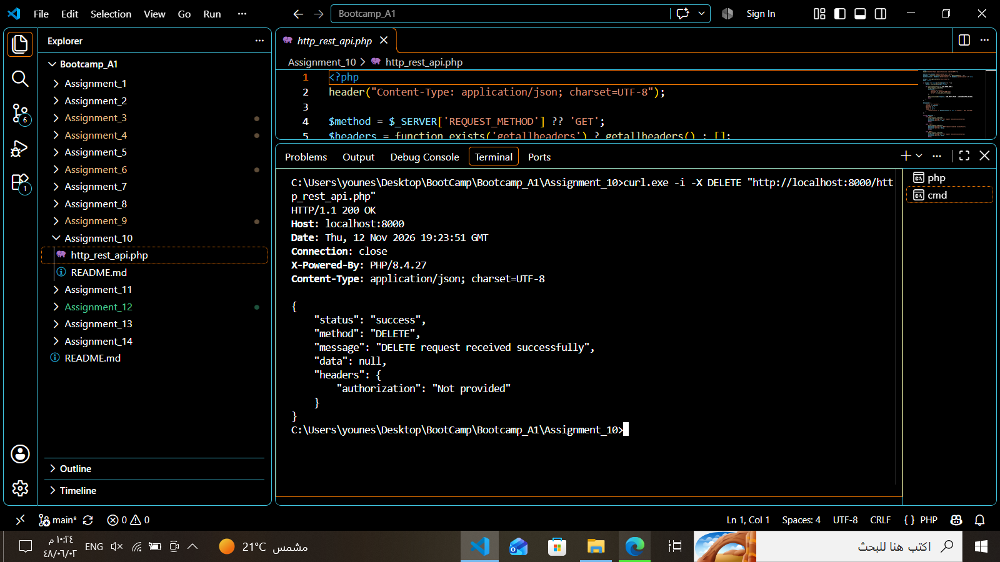
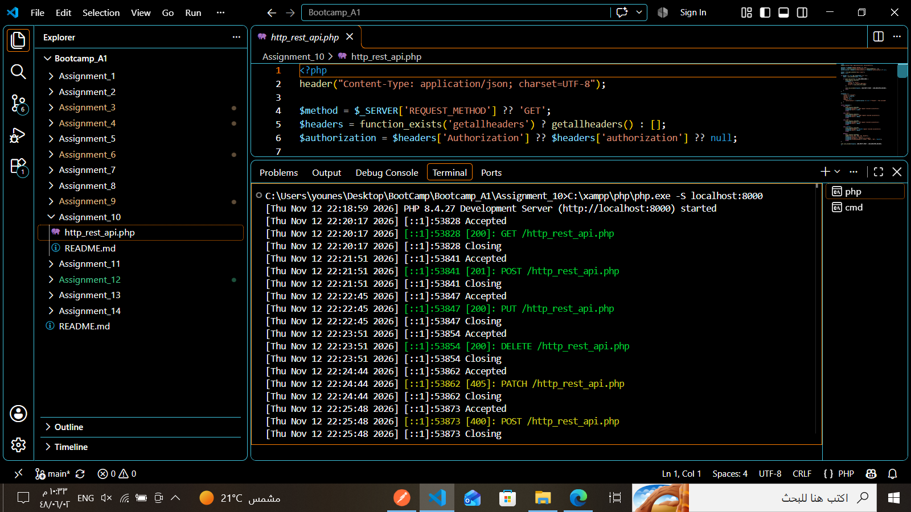

# Assignment 10 — PHP HTTP REST API

**Author:** Younes Al-Salami  
**Track:** Cybersecurity Programming Bootcamp  
**Programming Language:** PHP  
**Main File:** `http_rest_api.php`

---

## 1. Project Overview

This project implements a basic HTTP REST API using PHP. It receives HTTP requests, identifies the request method, reads request headers, processes JSON request bodies, and returns structured JSON responses.

The API supports four HTTP methods:

- **GET** — Receives a request and returns a success response.
- **POST** — Accepts JSON data and returns a creation response.
- **PUT** — Accepts JSON data and returns an update response.
- **DELETE** — Receives a deletion request and returns a success response.

The API also handles unsupported HTTP methods and invalid JSON input using appropriate HTTP status codes.

## 2. Learning Objectives

This assignment demonstrates how to:

- Understand HTTP request methods.
- Build a basic REST API using PHP.
- Read the request method using `$_SERVER['REQUEST_METHOD']`.
- Retrieve HTTP request headers.
- Read raw request data using `php://input`.
- Parse JSON using `json_decode()`.
- Generate JSON responses using `json_encode()`.
- Handle HTTP status codes.
- Validate JSON request bodies.
- Use `switch` statements to handle different request methods.

## 3. Requirements

- PHP 8.x recommended.
- XAMPP or PHP built-in development server.
- `curl.exe` for command-line testing.
- Postman is optional.
- No database is required.

## 4. Project Structure

```text
Assignment_10/
├── http_rest_api.php
└── README.md
```

## 5. How the API Works

### 5.1. Set the Response Content Type

The API returns JSON responses using:

```php
header("Content-Type: application/json; charset=UTF-8");
```

### 5.2. Identify the HTTP Method

The request method is obtained from:

```php
$_SERVER['REQUEST_METHOD']
```

### 5.3. Read Request Headers

The API retrieves the request headers and checks whether an Authorization header was provided.

### 5.4. Read and Decode JSON

The raw request body is read through `php://input` and decoded using `json_decode()`.

### 5.5. Handle HTTP Methods

A `switch` statement processes GET, POST, PUT, and DELETE requests.

### 5.6. Return Responses

The API returns structured JSON responses with appropriate HTTP status codes.

## 6. Running the Project

1. Install XAMPP.
2. Make sure PHP is available.
3. Open a terminal in the project directory.
4. Start the PHP development server:

```powershell
C:\xampp\php\php.exe -S localhost:8000
```

5. Keep the terminal running.
6. Use the following URL:

```text
http://localhost:8000/http_rest_api.php
```

## 7. API Testing

The API was tested locally using `curl.exe` from the Windows terminal.

### 7.1. GET Request

Command:

```powershell
curl.exe -i -X GET "http://localhost:8000/http_rest_api.php"
```

Expected status code: `200 OK`

The API returns a successful GET response and displays the received request information.



### 7.2. POST Request

Command:

```powershell
curl.exe -i -X POST "http://localhost:8000/http_rest_api.php" -H "Content-Type: application/json" -d "{\"username\":\"Younes\",\"email\":\"younes@example.com\"}"
```

Expected status code: `201 Created`

The API accepts the JSON data and returns the submitted values in its response.



### 7.3. PUT Request

Command:

```powershell
curl.exe -i -X PUT "http://localhost:8000/http_rest_api.php" -H "Content-Type: application/json" -d "{\"username\":\"Younes Updated\",\"email\":\"updated@example.com\"}"
```

Expected status code: `200 OK`

The API processes the update request and returns the submitted JSON data.



### 7.4. DELETE Request

Command:

```powershell
curl.exe -i -X DELETE "http://localhost:8000/http_rest_api.php"
```

Expected status code: `200 OK`

The API receives the DELETE method and returns a successful response.



## 8. Error Handling Tests

### 8.1. Unsupported HTTP Method

The API was tested using the PATCH method, which is not supported by this implementation.

Command:

```powershell
curl.exe -i -X PATCH "http://localhost:8000/http_rest_api.php"
```

Expected status code: `405 Method Not Allowed`

The response indicates that the requested method is not supported and identifies the allowed methods.


### 8.2. Invalid JSON Body

The API was also tested with malformed JSON data.

Command:

```powershell
curl.exe -i -X POST "http://localhost:8000/http_rest_api.php" -H "Content-Type: application/json" -d "{invalid json}"
```

Expected status code: `400 Bad Request`

The API detects the invalid JSON body and returns an error response.


## 9. API Implementation

The main PHP source file is:

`http_rest_api.php`

It contains the request handling logic, JSON parsing, HTTP method routing, and response generation.



## 10. Expected HTTP Status Codes

| Request / Test | HTTP Status |
|---|---:|
| GET | 200 OK |
| POST | 201 Created |
| PUT | 200 OK |
| DELETE | 200 OK |
| Unsupported method | 405 Method Not Allowed |
| Invalid JSON | 400 Bad Request |

## 11. Validation and Test Results

The PHP development server was started successfully, and the API was tested locally.

The following tests were completed:

| Test | Result |
|---|---|
| PHP syntax validation | Passed |
| Local PHP server startup | Passed |
| GET request | Passed |
| POST request | Passed |
| PUT request | Passed |
| DELETE request | Passed |
| Unsupported PATCH request | Passed |
| Invalid JSON handling | Passed |

The observed responses matched the implemented HTTP status handling.

## 12. Security Notes and Limitations

- Checking whether an Authorization header exists does not authenticate a user. A real API must validate credentials and permissions.
- HTTPS should be used to protect data in transit.
- Request data should be validated before being processed.
- Rate limiting and proper authentication should be added for production use.
- This assignment does not use a database. POST, PUT, and DELETE demonstrate request handling and response generation; they do not persist or modify actual records.

## 13. Author

**Younes Al-Salami**  
Cybersecurity Programming Bootcamp
