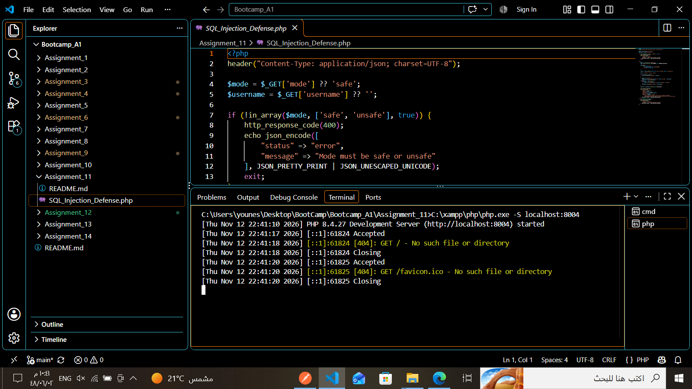

# Assignment 11 — PHP SQL Injection Defense

**Author:** Younes Al-Salami  
**Track:** Cybersecurity Programming Bootcamp  
**Programming Language:** PHP  
**Main File:** `SQL_Injection_Defense.php`

---

## 1. Project Overview

This project demonstrates SQL Injection vulnerabilities and how to prevent them using PHP PDO prepared statements.

It provides an interactive web interface that allows users to search for records and compare two query execution modes:

- **Safe Mode:** Uses PDO prepared statements to treat user input as data.
- **Unsafe Mode:** Inserts user input directly into the SQL query to demonstrate SQL Injection.

The project also includes a practical SQL Injection test using a sample payload to show the difference between the two approaches.

## 2. Learning Objectives

This assignment demonstrates how to:

- Understand SQL Injection vulnerabilities.
- Identify the risks of directly concatenating user input into SQL queries.
- Connect PHP to an SQLite database using PDO.
- Create and execute SQL queries.
- Use PDO `prepare()` and `execute()`.
- Compare unsafe SQL queries with prepared statements.
- Test SQL Injection using a controlled demonstration payload.
- Display database results through an HTML interface.

## 3. Requirements

- PHP 8.x recommended.
- PDO extension enabled.
- PDO SQLite driver (`pdo_sqlite`) enabled.
- XAMPP or PHP built-in development server.
- A modern web browser.
- No third-party PHP packages are required.

## 4. Project Structure

```text
Assignment_11/
├── SQL_Injection_Defense.php
└── README.md
```

## 5. How the Project Works

### 5.1. Database Initialization

The application creates an SQLite in-memory database and a users table.

It inserts sample user records for demonstration purposes, including:

- admin
- alice
- bob
- younes

The database is initialized when the PHP script runs. Its records are not stored permanently.

### 5.2. User Search

The user enters a username through the web interface and selects a query execution mode.

The application processes the submitted input and displays the matching records.

### 5.3. Safe Mode — Prepared Statements

Safe Mode uses PDO prepared statements.

The query is prepared separately from the supplied username, and the input is passed through `execute()`.

This prevents the supplied value from being interpreted as part of the SQL command.

### 5.4. Unsafe Mode — Direct SQL Query

Unsafe Mode inserts the supplied input directly into the SQL statement.

This approach is intentionally included to demonstrate how SQL Injection can change the meaning of a query.

It is for educational testing only and must not be used in production applications.

## 6. Running the Project

1. Install XAMPP or make sure PHP is available.
2. Ensure that PDO and `pdo_sqlite` are enabled.
3. Open a terminal inside the assignment directory.
4. Start the PHP development server:

```powershell
C:\xampp\php\php.exe -S localhost:8004
```

If PHP is already available in PATH, use:

```powershell
php -S localhost:8004
```

5. Open the following address in your browser:

```text
http://localhost:8004/SQL_Injection_Defense.php
```

6. The SQL Defense Lab interface should appear.

## 7. Application Interface

The application provides a username search form with two query modes:

- Safe — Prepared Statement
- Unsafe — Direct SQL Query (Demonstration)

The interface also includes a search results section and a practical SQL Injection test.



## 8. Testing and Demonstration

The following tests demonstrate how prepared statements protect database queries against SQL Injection.

### 8.1. Normal Search — Safe Mode

Test input:

```text
younes
```

Selected mode: `Safe - Prepared Statement`

Expected result:

- One matching record.
- The username `younes` is returned.
- The input is treated as a normal value.

Observed result: **1 record found.**


### 8.2. SQL Injection Payload

The demonstration uses the following input:

```sql
' OR '1'='1
```

This payload attempts to modify the condition of the SQL query.

The application provides two buttons to test the same input in Unsafe Mode and Safe Mode.


### 8.3. Safe Mode — SQL Injection Attempt

Selected mode: `Safe - Prepared Statement`

Input:

```sql
' OR '1'='1
```

Expected behavior:

- The payload is treated as a literal username.
- It does not modify the SQL query structure.
- No matching user should be returned.

Observed result: **0 records found.**


### 8.4. Unsafe Mode — SQL Injection Demonstration

Selected mode: `Unsafe - Direct SQL Query (Demonstration)`

Input:

```sql
' OR '1'='1
```

Expected behavior:

- The supplied input is inserted directly into the SQL query.
- The condition is modified.
- The query returns all four sample user records.

Observed result: **4 records found.**


### 8.5. Unsafe Mode — Returned Records

The results demonstrate that the injected condition affected the SQL query and returned records that would not normally match the supplied username.


## 9. Test Results Summary

| Test Case | Mode | Observed Result |
|---|---|---|
| Search for `younes` | Safe | 1 record found |
| SQL Injection payload | Safe | 0 records found |
| SQL Injection payload | Unsafe | 4 records found |

The results demonstrate why prepared statements are important for preventing SQL Injection.

## 10. Security Notes and Limitations

- Unsafe Mode is intentionally vulnerable and exists only for controlled educational demonstration.
- Never expose Unsafe Mode on a public or production server.
- Use PDO prepared statements for database queries involving user input.
- The application uses an in-memory SQLite database, so its sample records are recreated whenever the script runs.
- The demonstration focuses on SQL Injection prevention and is not a complete user authentication or database management system.
- The SQL Injection payload should only be tested against this local educational application or another explicitly authorized environment.

## 11. Validation Status

The application was opened and tested through a local PHP development server.

The browser tests demonstrated the following behavior:

- The application interface loaded successfully.
- Safe Mode returned one record for the normal username `younes`.
- Safe Mode returned zero records for the SQL Injection payload.
- Unsafe Mode returned four sample records for the same payload.

The observed results demonstrate the difference between direct SQL query construction and PDO prepared statements.

## 12. Author

**Younes Al-Salami**  
Cybersecurity Programming Bootcamp
