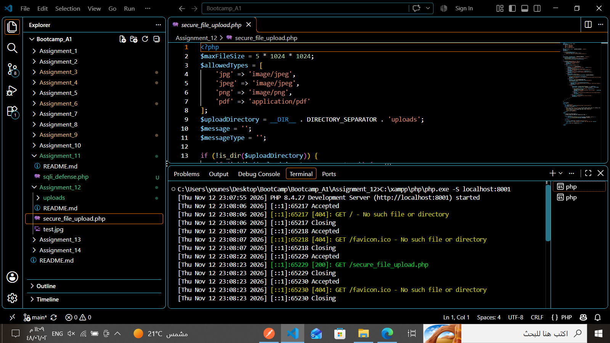
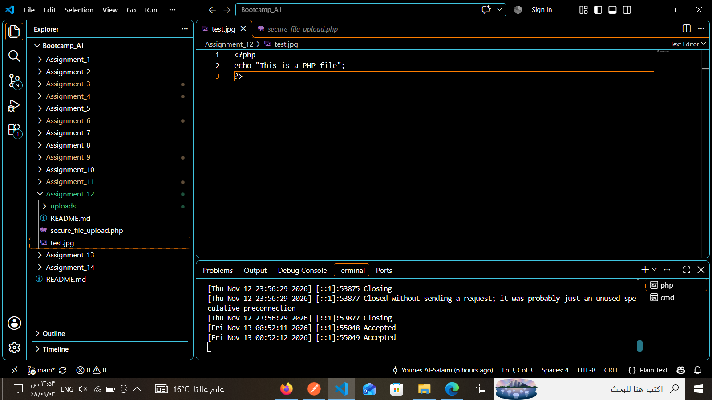
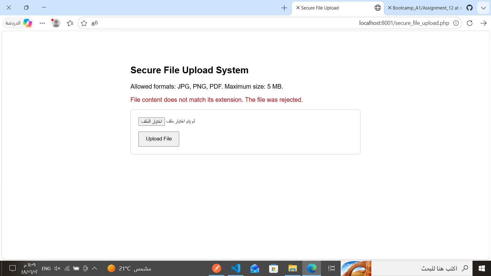
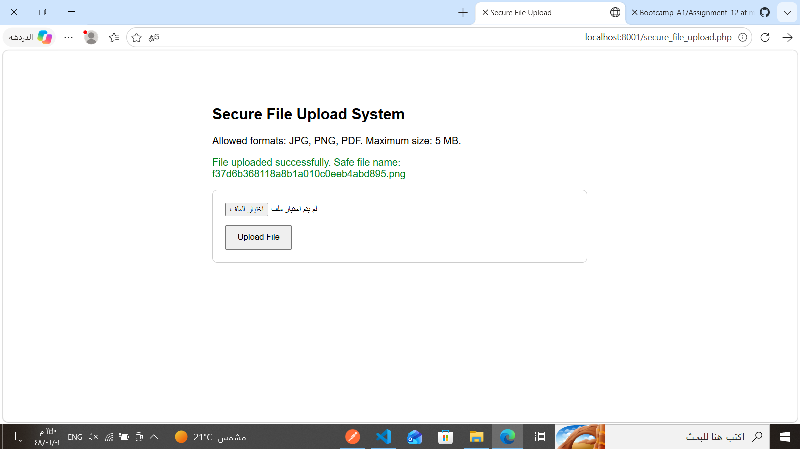

# Assignment 12 — PHP Secure File Upload System

**Author:** Younes Al-Salami  
**Track:** Cybersecurity Programming Bootcamp  
**Programming Language:** PHP  
**Main File:** `secure_file_upload.php`

---

## 1. Project Overview

This project implements a secure file upload system using PHP.

The application applies multiple validation techniques to reduce the risk of malicious file uploads. It checks the uploaded file's extension, size, and actual MIME type before accepting it.

It also generates a random filename to avoid trusting filenames supplied by users.

The application demonstrates both a successful upload and the rejection of a file containing PHP code disguised as a JPG image.

## 2. Learning Objectives

- Understand common risks associated with file uploads.
- Validate uploaded files using PHP.
- Restrict uploads to permitted file extensions.
- Check file content using MIME type detection.
- Enforce a maximum upload size.
- Generate random filenames.
- Use `move_uploaded_file()` to store uploaded files.
- Apply basic upload directory protection.

## 3. Requirements

- PHP 8.x recommended.
- Fileinfo extension enabled.
- XAMPP or PHP built-in development server.
- A modern web browser.
- Write permissions for the upload directory.

## 4. Project Structure

```text
Assignment_12/
│
├── secure_file_upload.php
├── README.md
│
└── uploads/
    └── Uploaded files are stored here
```

The `uploads` directory is created by the application if it does not already exist.

## 5. Security Features

### 5.1. File Size Validation

The application enforces a maximum file size of 5 MB.

### 5.2. Extension Validation

Only the following extensions are permitted:

- JPG
- JPEG
- PNG
- PDF

### 5.3. MIME Type Validation

The application uses PHP's `finfo_file()` to inspect the actual content type of an uploaded file.

This helps prevent an attacker from simply renaming a malicious file with an allowed image extension.

### 5.4. Random Filename Generation

The application generates a random filename using:

```php
bin2hex(random_bytes(16))
```

This avoids using the original user-supplied filename as the stored filename.

### 5.5. File Storage

The application uses `move_uploaded_file()` to move validated files into the `uploads` directory.

### 5.6. Upload Directory Protection

An `.htaccess` protection mechanism is included to restrict access or execution of uploaded files when supported by the Apache configuration.

## 6. Running the Project

Open a terminal inside the `Assignment_12` directory and start the PHP development server:

```powershell
C:\xampp\php\php.exe -S localhost:8001
```

Open the following URL in a browser:

```text
http://localhost:8001/secure_file_upload.php
```

The Secure File Upload System interface should appear.

## 7. Practical Testing

The following tests were performed using the local PHP development server.

### 7.1. Application Source and Server

The PHP source code defines the allowed file extensions, 5 MB size limit, and upload directory. The local development server was started on port 8001.



### 7.2. Malicious File Extension Test

A test file named `test.jpg` was created with PHP code as its content:

```php
<?php
echo "This is a PHP file";
?>
```

Although the filename uses the `.jpg` extension, its actual content is PHP code.

The application inspected the file content and rejected the upload because the detected MIME type did not match the allowed image type.



### 7.3. Rejected Upload Result

Observed application response:

```text
File content does not match its extension. The file was rejected.
```

This confirms that the application does not rely only on the filename extension when validating an uploaded file.



### 7.4. Successful PNG Upload

A valid PNG image was selected and submitted through the upload form.

Observed application response:

```text
File uploaded successfully.
```

The application generated a random filename for the uploaded image.



## 8. Test Results Summary

| Test Case | Observed Result |
|---|---|
| PHP code disguised as `.jpg` | Rejected |
| Valid PNG image | Accepted |
| Random filename generation | Observed |
| Local PHP server | Started successfully |

The 5 MB limit and PDF/JPG acceptance cases are implemented in the code but are not demonstrated by the supplied screenshots.

## 9. Security Considerations and Limitations

- MIME type validation is not a complete malware detection mechanism.
- A production application should consider malware scanning and image re-encoding.
- Uploaded files should preferably be stored outside the public web root.
- `.htaccess` protection depends on Apache configuration and does not apply to every web server.
- File permissions must be configured appropriately.
- The application should be combined with authentication, authorization, and upload quotas in a production environment.

## 10. Validation Status

The application was opened using the local PHP development server.

The supplied test evidence confirms:

- The upload interface loaded successfully.
- A PHP file disguised as a JPG image was rejected because its content did not match its extension.
- A valid PNG image was accepted.
- A random filename was generated for the accepted upload.

These results demonstrate the effectiveness of combining extension validation with MIME type inspection.

## 11. Author

**Younes Al-Salami**  
Cybersecurity Programming Bootcamp
