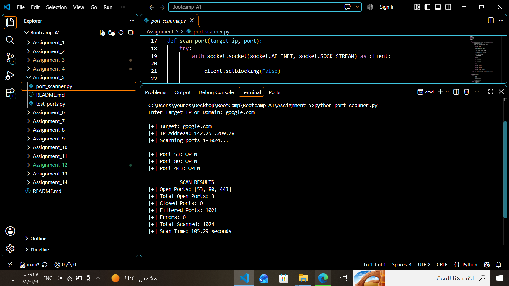

# Assignment 05 — Multithreaded TCP Port Scanner

**Author:** Younes Al-Salami  
**Track:** Cybersecurity Programming Bootcamp  
**Programming Language:** Python 3  
**Main Script:** `port_scanner.py`

---

## 1. Project Overview

This project is a multithreaded TCP port scanner. It accepts an IPv4 address or domain name, resolves the target to an IPv4 address, and checks TCP ports from **1 through 1024**.

The scanner uses non-blocking sockets and `select.select()` to monitor connection attempts. A `ThreadPoolExecutor` runs up to 50 port-scanning tasks concurrently.

Each scanned port is classified as:

- **OPEN** — The TCP connection was established.
- **CLOSED** — The target actively refused the connection.
- **FILTERED** — The connection attempt timed out or did not complete within the configured timeout.
- **ERROR** — Another socket or operating-system error occurred.

At the end of the scan, the program displays open ports, counts for each result category, the total number of scanned ports, and elapsed scan time.

## 2. Learning Objectives

This assignment demonstrates how to:

- Use Python's `socket` module to create TCP sockets.
- Resolve a domain name to an IPv4 address with `socket.getaddrinfo()`.
- Perform non-blocking connection attempts with `setblocking(False)` and `connect_ex()`.
- Use `select.select()` to wait for socket connection readiness.
- Inspect connection results through `getsockopt()` and `SO_ERROR`.
- Run concurrent tasks using `ThreadPoolExecutor`.
- Collect asynchronous task results with `as_completed()`.
- Measure execution time with `time.perf_counter()`.

## 3. Requirements

- Python 3.
- Network connectivity to the authorized target.
- Permission to scan the target system.
- No third-party Python packages are required.

The implementation uses Windows socket error codes for several connection outcomes. Its status mapping is therefore designed primarily for Windows.

## 4. Project Structure

```text
Assignment_05/
├── port_scanner.py
└── port_scanner.png
```

## 5. Configuration

The script defines the following main settings:

| Setting | Value | Description |
|---|---:|---|
| `MAX_WORKERS` | `50` | Maximum number of concurrent worker threads |
| `TIMEOUT` | `5` seconds | Maximum wait used by `select.select()` for a pending connection |
| Port range | `1–1024` | Ports checked by the scanner |
| Address family | `AF_INET` | IPv4 TCP scanning |

The effective `TIMEOUT` is 5 seconds because the later assignment `TIMEOUT = 5` replaces the earlier value of 1. The scanner's main function submits exactly 1024 port checks.

## 6. How the Program Works

### 6.1 Read and Validate the Target

The program asks the user to enter a target IP address or domain name. An empty input is rejected.

### 6.2 Resolve the Domain Name

`resolve_domain()` calls:

```python
socket.getaddrinfo(
    target,
    None,
    socket.AF_INET,
    socket.SOCK_STREAM
)
```

It requests an IPv4 TCP address. If DNS resolution fails, it retries once after a one-second delay. If resolution still fails, the scan stops with an error message.

### 6.3 Scan Each TCP Port

`scan_port()` creates a TCP socket and sets it to non-blocking mode:

```python
client.setblocking(False)
```

It then calls `connect_ex()` to attempt a connection.

- A return value of `0` means the connection succeeded.
- On Windows, return values such as `10035`, `10036`, and `10037` indicate that the non-blocking connection is still in progress.
- For a pending connection, `select.select()` waits for the socket to become writable or exceptional.
- The program then reads `SO_ERROR` to determine whether the connection succeeded or failed.

### 6.4 Run Scans Concurrently

The program creates a `ThreadPoolExecutor` with up to 50 workers and submits one task for every port in the range 1–1024.

`as_completed()` collects results as individual scans finish. Open ports are printed immediately, while other result categories are counted for the final report.

### 6.5 Display the Summary

The program calculates elapsed time with `time.perf_counter()` and displays:

- List of open ports.
- Number of open ports.
- Number of closed ports.
- Number of filtered ports.
- Number of errors.
- Total ports scanned.
- Total scan time.

## 7. How to Run

1. Install Python 3 if it is not already installed.
2. Save the code as `port_scanner.py`.
3. Open a terminal in the directory containing the file.
4. Run:

```bash
python port_scanner.py
```

On Windows, the Python launcher can also be used:

```powershell
py port_scanner.py
```

5. Enter an IPv4 address or domain name when prompted.
6. Wait for the scan summary.

## 8. Example Execution

Example input:

```text
Enter Target IP or Domain: 192.168.1.1
```

The output format is similar to:

```text
[+] Target: 192.168.1.1
[+] IP Address: 192.168.1.1
[+] Scanning ports 1-1024...

[+] Port 80: OPEN
[+] Port 443: OPEN

========== SCAN RESULTS ==========
[+] Open Ports: [80, 443]
[+] Total Open Ports: 2
[+] Closed Ports: ...
[+] Filtered Ports: ...
[+] Errors: ...
[+] Total Scanned: 1024
[+] Scan Time: ... seconds
==================================
```

The addresses and results above are illustrative only. Actual results depend on the target, network path, firewall rules, and services listening at scan time.

### Screenshot — Port Scanner Execution

<!-- أضف الصورة port_scanner.png هنا بعد وضعها في المجلد نفسه الذي يحتوي على README.md -->



## 9. Result Interpretation

| Status | Meaning |
|---|---|
| `OPEN` | A TCP connection was successfully established. A service may be listening on the port. |
| `CLOSED` | The target refused the TCP connection. |
| `FILTERED` | The attempt timed out or did not become ready within the configured wait. A firewall or packet filtering may be involved, but this status alone does not prove why the connection failed. |
| `ERROR` | The socket operation returned another error that the script did not classify as open, closed, or filtered. |

A port status is a point-in-time observation. It does not identify the application or prove that the service is vulnerable.

## 10. Validation and Test Status

This README documents the behavior of the supplied source code. No new scan against an external target is claimed here.

Before submitting the assignment, run the program against a lab machine or another system for which you have explicit authorization. Verify that the program completes and that its summary reports a total of 1024 scanned ports.

Useful controlled tests include:

1. Scan a lab host with a known TCP service listening on a port in the range.
2. Scan a port on the lab host that is known to be closed.
3. Compare results when a firewall blocks or drops connection attempts.
4. Repeat the scan to observe that results and elapsed time can vary.

## 11. Technical Notes and Limitations

- The scanner checks TCP only; it does not scan UDP.
- It checks ports 1–1024 only; ports above 1024 are not included.
- `AF_INET` limits resolution and scanning to IPv4.
- The Windows error values (`10035`, `10036`, `10037`, `10061`, and `10060`) are platform-specific. The status mapping may need changes for Linux or macOS.
- A timeout is classified as `FILTERED`, but network delay or packet loss can also cause timeouts.
- The script does not identify service names, versions, or vulnerabilities.
- The code contains repeated imports and an earlier `TIMEOUT` assignment; the effective timeout is the later value of 5 seconds. These do not prevent the described program flow, but can be cleaned up in a future revision.
- The `errno` import is not used by the active implementation.

## 12. Responsible Use

Only scan systems you own or have explicit permission to test. Port scanning can trigger security alerts and may be restricted by organizational policy or law. Use a controlled lab environment for coursework and demonstrations.

## 13. Author

**Younes Al-Salami**  
Cybersecurity Programming Bootcamp
