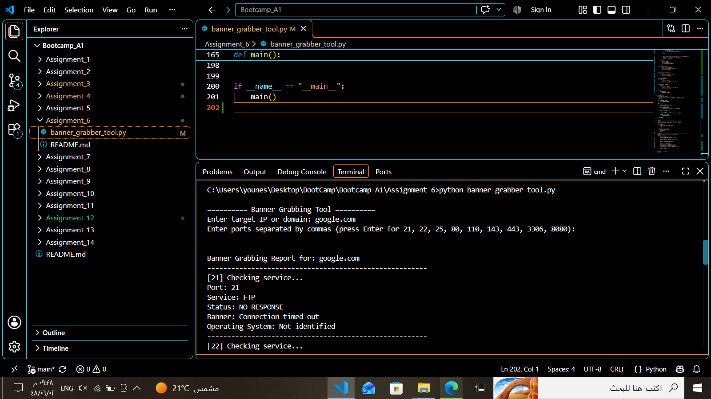
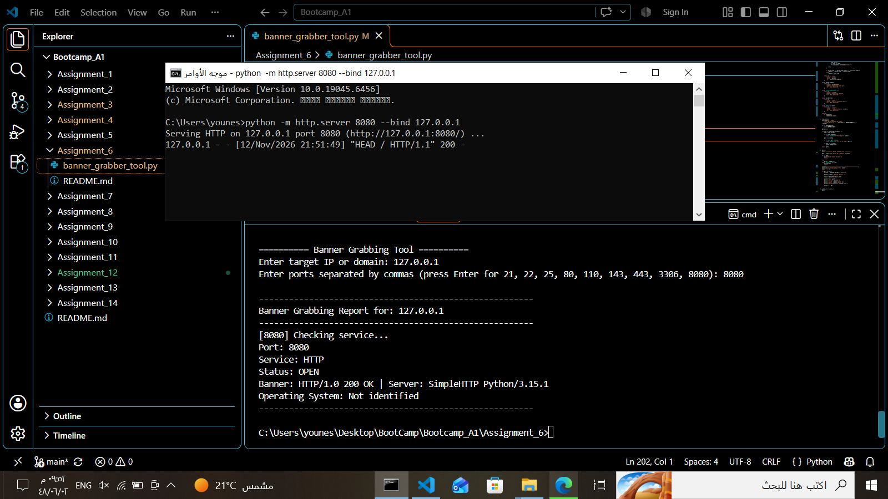
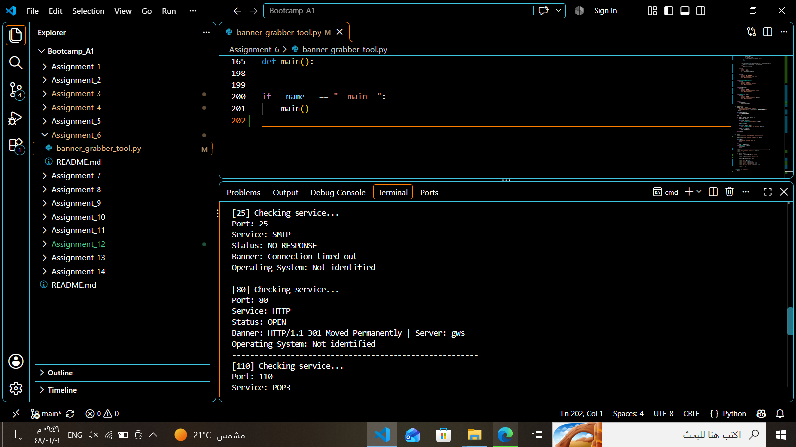

# Assignment 06 — Banner Grabbing Tool

**Author:** Younes Al-Salami  
**Track:** Cybersecurity Programming Bootcamp  
**Programming Language:** Python 3  
**Main File:** `banner_grabber_tool.py`

---

## 1. Project Overview

A TCP Banner Grabbing Tool that connects to a specified host and port, retrieves available service responses, and displays information that can help identify the running service.

The tool demonstrates TCP socket communication, connection timeouts, response decoding, and HTTP HEAD requests.

For each tested port, the program displays:

- **Port:** The TCP port being checked.
- **Service:** The service associated with the port.
- **Status:** The connection result, such as `OPEN` or `NO RESPONSE`.
- **Banner:** The response received from the service or the connection error.
- **Operating System:** Operating system information when identifiable from the available response.

## 2. Learning Objectives

This assignment demonstrates how to:

- Create TCP connections using Python's `socket` module.
- Connect to a specified host and port.
- Configure socket connection timeouts.
- Receive and decode server responses.
- Send HTTP HEAD requests to web services.
- Extract useful information from HTTP response headers.
- Handle connection errors and timeouts.
- Display structured service information in a terminal report.

## 3. Requirements

- Python 3.
- Network access to the authorized target.
- No third-party Python packages are required.

## 4. Project Structure

```text
Assignment_06/
├── banner_grabber_tool.py
├── banner_grabber_tool.png
├── banner_grabber_tool1.png
└── banner_grabber_tool2.png
```

## 5. How the Program Works

1. The program asks the user to enter a target IP address or domain name.
2. The user enters the ports to check, or presses Enter to use the default ports.
3. The program creates a TCP socket and configures a connection timeout.
4. It attempts to connect to the specified host and port.
5. For HTTP and HTTPS services, it sends an HTTP HEAD request.
6. It receives up to 1024 bytes from the service and decodes the response.
7. It extracts available banner information and displays the service details.
8. Connection errors and timeouts are handled and reported.

## 6. How to Run

1. Install Python 3 if it is not already installed.
2. Open a terminal in the directory containing `banner_grabber_tool.py`.
3. Run the program:

```bash
python banner_grabber_tool.py
```

On Windows, you can also use:

```powershell
py banner_grabber_tool.py
```

4. Enter the target IP address or domain name.
5. Enter the desired ports separated by commas, or press Enter to use the default ports.

Default ports:

```text
21, 22, 25, 80, 110, 143, 443, 3306, 8080
```

## 7. Example Output

The program displays a report for each tested port. The output format includes:

```text
Port: 8080
Service: HTTP
Status: OPEN
Banner: HTTP/1.0 200 OK
Operating System: Not identified
```

The displayed values are examples of the output structure. Actual results depend on the target service and its response.

## 8. Screenshots

The following screenshots document the tool's execution and demonstrate different connection results.

### 8.1. Banner Grabbing Against a Domain

<!-- ضع الصورة banner_grabber_tool.png هنا: توضح تشغيل الأداة ضد google.com ونتيجة فحص المنفذ 21 -->



### 8.2. Testing an HTTP Service on a Local Port

<!-- ضع الصورة banner_grabber_tool2.png هنا: توضح تشغيل خادم HTTP محلي على المنفذ 8080 واكتشاف الخدمة وحالة الاتصال والـ Banner -->



### 8.3. Additional Port Scanning Results

<!-- ضع الصورة banner_grabber_tool1.png هنا: توضح نتائج فحص منافذ إضافية، بما فيها استجابة HTTP على المنفذ 80 وعدم استجابة المنفذ 25 -->



## 9. Result Interpretation

| Field | Description |
|---|---|
| `Port` | The TCP port being tested. |
| `Service` | The service associated with the selected port. |
| `Status: OPEN` | A TCP connection was successfully established. |
| `Status: NO RESPONSE` | No usable service response was received within the configured timeout or connection attempt. |
| `Banner` | The received service response or the reported connection error. |
| `Operating System` | Operating system information when identifiable; otherwise, `Not identified`. |

A successful connection does not necessarily mean that the service will disclose a banner. Some services require a protocol-specific request before sending information.

## 10. Validation and Test Status

The supplied screenshots demonstrate the following test scenarios:

1. A connection attempt against `google.com`, including a timeout on port 21.
2. A local HTTP server running on `127.0.0.1:8080`, where the tool received an HTTP response and identified the HTTP service.
3. Additional connection attempts against `google.com`, including an HTTP response on port 80 and a timeout on port 25.

The screenshots provide evidence of these specific executions. They do not establish that every supported service or port has been tested.

## 11. Limitations and Responsible Use

- The tool checks TCP services only.
- Some services do not send a banner until they receive a protocol-specific request.
- A connection timeout does not prove that a port is closed.
- Operating system identification may not be possible from the available banner.
- Banner information is an identification clue, not proof of a service version or vulnerability.
- Results depend on service availability, network connectivity, firewall rules, and the target's configuration.

Only test systems you own or have explicit permission to assess.

## 12. Author

**Younes Al-Salami**  
Cybersecurity Programming Bootcamp
