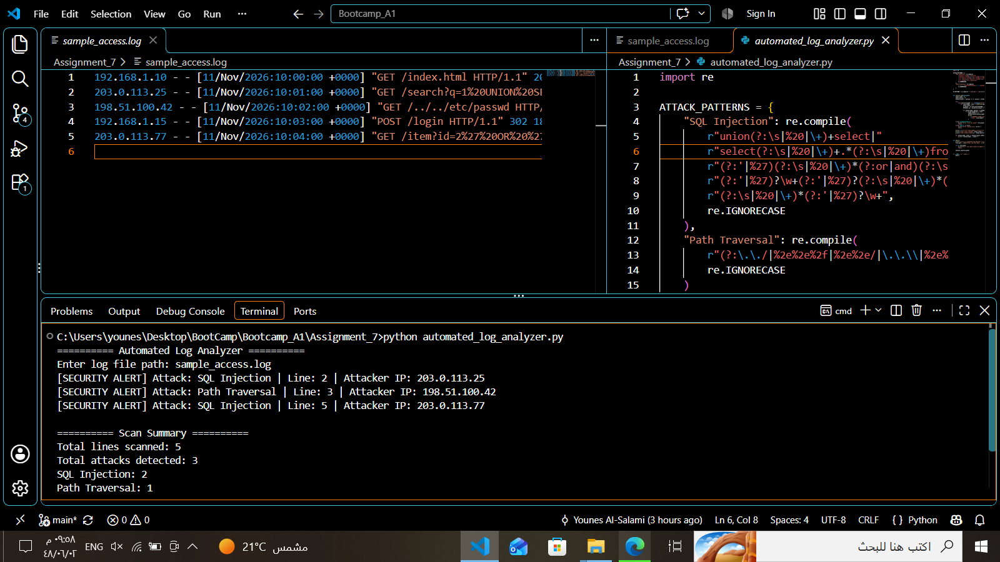

# Assignment 07 — Automated Log Analyzer

**Author:** Younes Al-Salami  
**Track:** Cybersecurity Programming Bootcamp  
**Programming Language:** Python 3  
**Main Files:** `automated_log_analyzer.py`, `sample_access.log`

---

## 1. Project Overview

This project is a Python-based Automated Log Analyzer that reads web access logs line by line and searches for suspicious patterns associated with SQL Injection and Path Traversal attacks.

The analyzer uses regular expressions to identify potentially malicious requests and reports suspicious entries with their line numbers and attacker IP addresses where available.

At the end of the analysis, the program displays a summary containing the total number of scanned lines and the number of detected indicators for each attack category.

## 2. Learning Objectives

This assignment demonstrates how to:

- Read and process text files using Python.
- Use `with open()` for safe file handling.
- Process log files line by line.
- Apply regular expressions using Python's `re` module.
- Identify suspicious SQL Injection patterns.
- Detect Path Traversal indicators.
- Extract IP addresses and line numbers from log entries.
- Generate security alerts and detection summaries.

## 3. Requirements

- Python 3.
- A web access log compatible with the patterns used in the script.
- No third-party Python packages are required.

## 4. Detection Scope

The analyzer searches for two categories of suspicious activity:

### 4.1. SQL Injection

Identifies request patterns that may indicate SQL Injection attempts, including suspicious SQL keywords and expressions.

### 4.2. Path Traversal

Identifies suspicious path patterns that may indicate attempts to access files outside the intended directory.

A detected pattern indicates suspicious input. It does not prove that an attack succeeded or that the target system was compromised.

## 5. Project Structure

```text
Assignment_07/
├── automated_log_analyzer.py
├── sample_access.log
├── automated_log_analyzer.png
└── README.md
```

## 6. How the Program Works

1. The program asks the user to enter the log file path.
2. It opens the specified file using `with open(...)`.
3. It reads the file one line at a time.
4. Each line is checked against the configured regular expressions.
5. When a suspicious pattern is detected, the program extracts the line number and IP address where available.
6. It displays a security alert containing the detected attack category and relevant information.
7. After processing the file, it displays a summary of the analysis results.

## 7. How to Run

1. Install Python 3 if it is not already installed.
2. Place `automated_log_analyzer.py` and `sample_access.log` in the same directory.
3. Open a terminal in the project directory.
4. Run:

```bash
python automated_log_analyzer.py
```

On Windows, you can also use:

```powershell
py automated_log_analyzer.py
```

5. When prompted, enter the log file path:

```text
sample_access.log
```

The program will analyze the file and display the detected security alerts.

## 8. Example Execution

The following example illustrates the detection output format:

```text
========== Automated Log Analyzer ==========

Enter log file path: sample_access.log

[SECURITY ALERT] Attack: SQL Injection | Line: 2 | Attacker IP: 203.0.113.25
[SECURITY ALERT] Attack: Path Traversal | Line: 3 | Attacker IP: 198.51.100.42
[SECURITY ALERT] Attack: SQL Injection | Line: 5 | Attacker IP: 203.0.113.77

========== Scan Summary ==========

Total lines scanned: 5
Total attacks detected: 3
SQL Injection: 2
Path Traversal: 1
```

The example represents the documented test log. Actual results depend on the contents of the analyzed log file.

### Screenshot — Automated Log Analyzer Execution

The following screenshot demonstrates the analyzer running against `sample_access.log`, showing the detection rules, suspicious log entries, security alerts, and final scan summary.



## 9. Validation and Test Status

The analyzer was executed against a sample test log.

The test successfully detected:

| Detection Category | Detected Count |
|---|---:|
| SQL Injection | 2 |
| Path Traversal | 1 |
| **Total Detected Indicators** | **3** |

The program scanned five log lines and reported the corresponding line numbers and IP addresses.

The screenshot provides evidence of this execution.

## 10. Technical Notes and Limitations

- Detection is based on regular expressions and configured patterns.
- Regex-based detection can produce false positives and false negatives.
- Encoding, obfuscation, and different log formats may require additional detection rules.
- A detected pattern does not prove that an attack was successful.
- The analyzer does not automatically block IP addresses or prevent attacks.
- The accuracy of IP extraction depends on the format of the analyzed log entries.

## 11. Responsible Use

Analyze only log files that you own or are authorized to access.

Log files may contain sensitive information, including IP addresses, request data, and user activity. Protect analyzed files and their results appropriately.

## 12. Author

**Younes Al-Salami**  
Cybersecurity Programming Bootcamp
