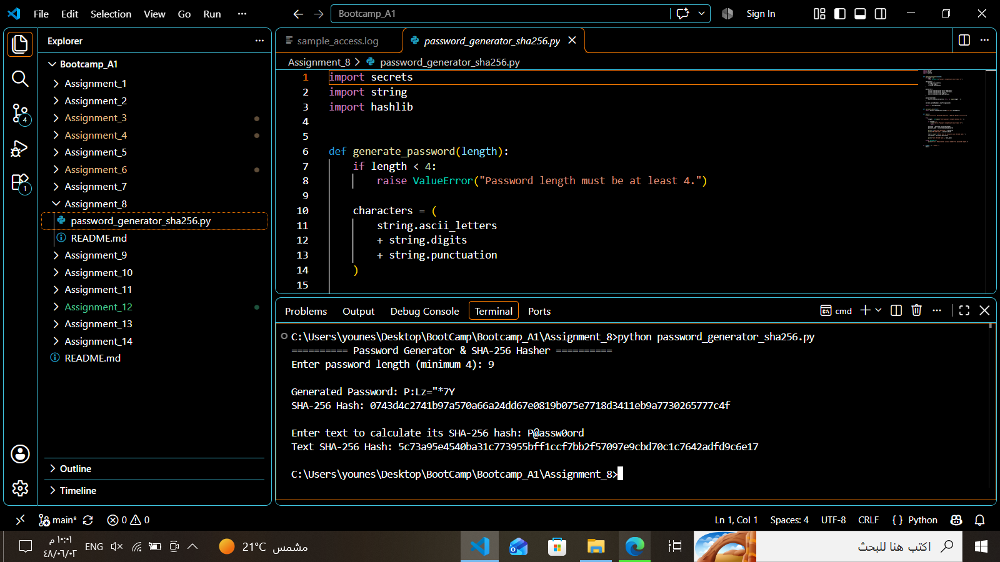

# Assignment 08 — Password Generator and SHA-256 Hasher

**Author:** Younes Al-Salami  
**Track:** Cybersecurity Programming Bootcamp  
**Programming Language:** Python 3  
**Main File:** `password_generator_sha256.py`

---

## 1. Project Overview

This project is a Python-based Password Generator and SHA-256 Hasher. It generates random passwords and calculates SHA-256 cryptographic digests for text input using Python's standard library.

The program demonstrates secure random password generation, character selection, text encoding, and cryptographic hashing.

## 2. Learning Objectives

This assignment demonstrates how to:

- Generate random passwords using Python's `secrets` module.
- Work with uppercase letters, lowercase letters, digits, and symbols.
- Use the `string` module to define character groups.
- Validate password length.
- Convert text into bytes using `.encode()`.
- Calculate SHA-256 digests using `hashlib`.
- Display hexadecimal hash values using `.hexdigest()`.

## 3. Requirements

- Python 3.
- Standard Python modules:
  - `secrets`
  - `string`
  - `hashlib`
- No third-party packages are required.

## 4. Features and Implementation

### 4.1. Secure Password Generation

The program uses Python's `secrets` module to select random characters for password generation.

The character pool includes:

- Uppercase letters.
- Lowercase letters.
- Numeric digits.
- Punctuation and symbols.

### 4.2. Password Length Validation

The program enforces a minimum password length of four characters. Shorter values are rejected with a validation error.

### 4.3. SHA-256 Hashing

The program calculates a SHA-256 digest for the generated password and for additional text entered by the user.

The hashing process uses:

```python
hashlib.sha256(text.encode()).hexdigest()
```

The result is displayed as a hexadecimal string.

## 5. Project Structure

```text
Assignment_08/
├── password_generator_sha256.py
├── password_generator_sha256.png
└── README.md
```

## 6. How to Run

1. Install Python 3 if it is not already installed.
2. Open a terminal in the directory containing `password_generator_sha256.py`.
3. Run:

```bash
python password_generator_sha256.py
```

On Windows, you can also use:

```powershell
py password_generator_sha256.py
```

4. Enter the desired password length when prompted.
5. The program generates a password and displays its SHA-256 hash.
6. Enter additional text when requested to calculate its SHA-256 digest.

## 7. Example Execution

The program displays the generated password and its SHA-256 digest, then asks the user to enter additional text for hashing.

Example output format:

```text
========== Password Generator & SHA-256 Hasher ==========

Enter password length (minimum 4): 9

Generated Password: [Generated Password]
SHA-256 Hash: [Generated SHA-256 Digest]

Enter text to calculate its SHA-256 hash: [Input Text]
Text SHA-256 Hash: [Calculated SHA-256 Digest]
```

The generated password and hash values will differ between executions because password generation uses secure random selection.

### Screenshot — Password Generation and SHA-256 Hashing

The following screenshot demonstrates the program running, generating a password, calculating its SHA-256 digest, and hashing additional user-provided text.



## 8. Validation and Test Status

The following validation steps were performed:

- Python syntax was checked.
- Password generation was exercised with lengths of 4, 8, 16, and 32 characters.
- The SHA-256 known test vector for the input `abc` was checked.
- The program was executed successfully.

The screenshot provides an example of the program's execution and output.

## 9. Security Notes

- The `secrets` module is suitable for generating security-sensitive random values.
- Generated passwords should be treated as confidential information.
- Plain SHA-256 is not suitable for production password storage because it is a fast hashing algorithm.
- Password storage systems should use dedicated password-hashing algorithms such as Argon2id or bcrypt with appropriate parameters.
- Do not commit generated passwords or other secrets to source control.

## 10. Limitations

- This is an educational utility, not a password manager or account-storage system.
- SHA-256 is deterministic: identical input produces an identical digest.
- The program calculates hashes but does not store or verify user passwords against an authentication database.

## 11. Author

**Younes Al-Salami**  
Cybersecurity Programming Bootcamp
