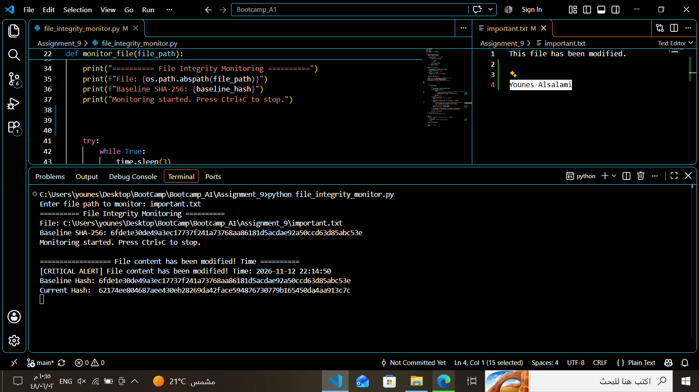
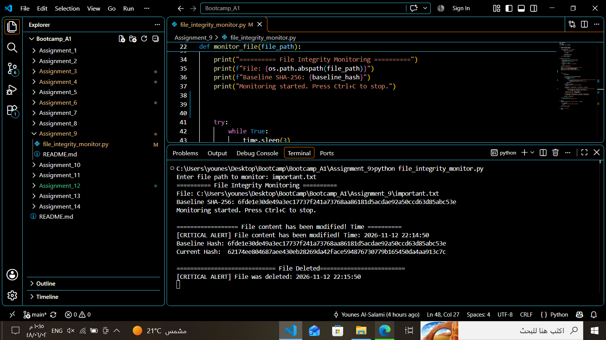

# Assignment 09 — File Integrity Monitoring (FIM)

**Author:** Younes Al-Salami  
**Track:** Cybersecurity Programming Bootcamp  
**Programming Language:** Python 3  
**Main File:** `file_integrity_monitor.py`

---

## 1. Project Overview

This project is a Python-based File Integrity Monitoring (FIM) tool that monitors files and detects unauthorized changes or deletions using SHA-256 cryptographic hashes.

The program calculates an initial hash for the monitored file and stores it as a baseline. During continuous monitoring, it recalculates the file hash and compares it with the original value to identify changes in file content.

When a modification or deletion is detected, the program generates a security alert containing the relevant information.

## 2. Learning Objectives

This assignment demonstrates how to:

- Monitor files using Python.
- Read file contents in binary mode.
- Calculate SHA-256 hashes using the `hashlib` module.
- Process files in chunks to avoid loading the entire file into memory.
- Create an initial integrity baseline.
- Compare current file hashes with baseline hashes.
- Detect file modifications and deletions.
- Use continuous monitoring with `while True` and `time.sleep()`.
- Handle keyboard interruption using `Ctrl+C`.

## 3. Requirements

- Python 3.
- Standard Python modules:
  - `hashlib`
  - `time`
  - Filesystem functions used by the script.
- No third-party packages are required.

## 4. Project Structure

```text
Assignment_09/
├── file_integrity_monitor.py
├── important.txt
├── file_integrity_monitor.png
├── Deleted_file_integrity_monitor.png
└── README.md
```

## 5. How the Program Works

### 5.1. Read the File

The program reads the monitored file in binary mode to calculate its content hash accurately.

### 5.2. Calculate SHA-256

The `hashlib` module calculates the SHA-256 digest using 4096-byte chunks.

This approach avoids loading the entire file into memory at once.

### 5.3. Create the Baseline

The initial SHA-256 hash is stored as the baseline value representing the original file content.

### 5.4. Continuous Monitoring

The program enters a continuous monitoring loop and checks the file every three seconds using:

```python
time.sleep(3)
```

### 5.5. Detect File Modifications

If the current SHA-256 hash differs from the baseline hash, the program detects a content modification and displays a critical security alert.

### 5.6. Detect File Deletions

If the monitored file no longer exists, the program detects its deletion and displays a corresponding security alert.

## 6. How to Run

1. Install Python 3 if it is not already installed.
2. Place `file_integrity_monitor.py` and the target file in the project directory.
3. Open a terminal in the project directory.
4. Run:

```bash
python file_integrity_monitor.py
```

On Windows, you can also use:

```powershell
py file_integrity_monitor.py
```

5. Enter the path of the file you want to monitor:

```text
important.txt
```

6. Allow the program to calculate the baseline and start monitoring.

## 7. Recommended Manual Test

The following steps demonstrate the main monitoring functions:

1. Create a test file named `important.txt`.
2. Start the monitoring program.
3. Allow it to calculate the initial SHA-256 baseline.
4. Modify the contents of `important.txt`.
5. Wait for the next monitoring cycle and verify the modification alert.
6. Delete the monitored file.
7. Verify that the program reports the deletion.
8. Stop the monitoring process using `Ctrl+C`.

## 8. Screenshots

The following screenshots demonstrate the actual execution of the File Integrity Monitoring tool and its detection results.

### 8.1. File Modification Detection

The screenshot demonstrates the monitoring process detecting a change in file content.

It displays:

- The monitored file path.
- The initial SHA-256 baseline.
- The modification alert.
- The current SHA-256 hash after modification.



### 8.2. File Deletion Detection

The screenshot demonstrates the tool detecting the deletion of the monitored file and generating a critical security alert.



## 9. Validation and Test Status

The following tests were performed:

| Test | Result |
|---|---|
| Python syntax check | Passed |
| SHA-256 hash calculation | Passed |
| Before-and-after hash comparison | Passed |
| File modification detection | Demonstrated in screenshot |
| File deletion detection | Demonstrated in screenshot |
| Continuous monitoring | Demonstrated in screenshots |

The provided screenshots document successful modification and deletion detection during execution.

## 10. Technical Notes and Limitations

- The monitoring interval is three seconds.
- SHA-256 detects content changes but does not identify who modified a file.
- A local baseline is not tamper-proof if an attacker can modify both the monitored file and its baseline.
- The tool is an educational FIM implementation, not an enterprise endpoint security product.
- The program monitors the specified file path and depends on having permission to access it.

## 11. Responsible Use

Monitor only files and systems that you own or are authorized to assess.

For stronger integrity protection, the baseline should be stored in a protected location that cannot be modified by the same unauthorized user who may alter the monitored files.

## 12. Author

**Younes Al-Salami**  
Cybersecurity Programming Bootcamp
